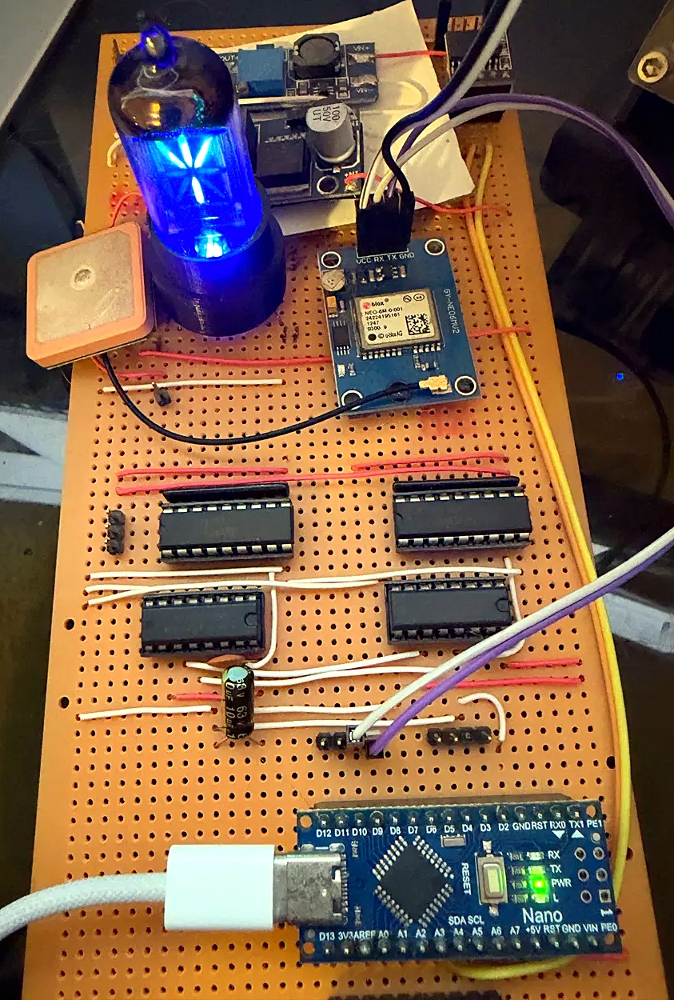

IV-4 GPS Tube Clock
A single-tube VFD clock that spells out the time one digit at a time on a Soviet-era IV-4
16-segment tube, with animated numerals. It sets itself from GPS satellites and keeps time on a
DS3231 real-time clock, so it never needs WiFi or setting by hand.
This was my first ever microcontroller project. It took a long time, borrowed ideas from many people,
and has been running reliably since early 2024.

How it works
One tube, four digits. The IV-4 can only show one character at a time, so the clock shows the
time as a sequence: hour tens, hour units, minute tens, minute units. Each numeral builds up in
animated layers rather than just switching on. A full time cycle takes about 7–8 seconds.
GPS sets the time. At power-up the tube shows a "waiting" symbol until the GPS hears a satellite.
The clock only needs the time from the first satellite it picks up, not a full position fix, so it
starts even on a weak signal away from a window. The time is converted from UTC to local time.
The RTC keeps the time. A DS3231 keeps accurate time between GPS syncs, and its backup cell
carries it through power cuts.

Nightly resync. At 3am the clock quietly checks the GPS again and corrects the RTC.
No GPS? No problem. If there's no GPS time after 5 minutes at power-up, it carries on using the RTC.

Parts list

1	IV-4 VFD tube	16-segment alphanumeric, Soviet era
1	3D-printed tube holder	Holds the tube upright on the board
1	Arduino Nano clone, USB-C	Shows PE0/PE1 pins, so likely an ATmega328PB-type clone. Uses the Old Bootloader setting
1	GY-NEO6MV2 GPS module (u-blox NEO-6M)	With ceramic patch antenna on a u.FL lead. TX → D9, RX → D10
1	DS3231 RTC module	SDA → A4, SCL → A5. Rechargeable backup cell soldered on
2	74HC595 shift registers (16-pin DIP)	Load the segment and grid data <!-- confirm part number -->
2	High-voltage driver chips (18-pin DIP)	Switch the tube's segments and grid at high voltage, e.g. UDN2981 / TD62783 <!-- confirm part number -->
1	DC-DC boost module	High voltage for the tube's anodes and grid <!-- add output voltage -->
1	DC-DC converter module	Low-voltage supply for the tube's filament <!-- confirm type and voltage -->
4	100 nF ceramic capacitors	One on each shift register / driver chip
1	10 µF 63 V electrolytic capacitor	Across the board supply
4	IC sockets (2 × 16-pin, 2 × 18-pin)	Optional, but makes swapping chips easy
1	Perfboard / veroboard	Roughly 100 × 200 mm
—	Pin headers and Dupont jumper leads	For the GPS, RTC and module connections
—	Solid-core hookup wire	Red for power, white for signals, as in the photo
1	USB-C cable and 5 V USB power supply	Powers everything
Pins D11 and D12 are spare.

Software setup (Arduino IDE)
Install these libraries from the Library Manager:
RTClib by Adafruit
TinyGPSPlus by Mikal Hart
Open `firmware/TubeClock_v2/TubeClock_v2.ino`.
Board: Arduino Nano. Processor: ATmega328P (Old Bootloader) for most clones.
If no port appears, install the CH340 USB driver.
Upload. The Serial Monitor (9600 baud) shows the GPS sync and each time shown.
Useful settings near the top of the sketch:
Time zone offset from UTC (set for Brisbane, UTC+10, no daylight saving)
`RESYNC_HOUR`: the hour of the nightly GPS resync (default 3am)

Versions

v2.0 (Nov 2026): non-blocking rewrite. No `delay()` anywhere; the display runs as a `millis()`
state machine. GPS decoded by TinyGPS++ with checksum checks. RTC set from GPS UTC plus the time zone,
with proper date rollover. Starts on the first satellite it hears; no full position fix needed.Nightly 
3am resync. Boot sync gives up after 5 minutes and runs on the RTC.

v1.2 (2024): the original hand-written version that ran for over 20 months. Kept as a fallback in
`firmware/TubeClock_v1_2/`.
Build log
Mar 2024: working GPS sync. Updated numerals 1 and 7, added a check for 0 seconds in the NMEA string.
Mar 2024: animated numerals, optimised byte shifting with a shared function, lookup converted to a
2D array. Fitted 100 nF caps to each shift register and 10 µF across the board power. Fixed a crash
caused by an oversized time string.
May 2024: tried moving it to a Waveshare ESP32. No go, so it stayed on the Nano clone.
Aug 2025: running for 15 months with no issues.
Jan 2026: running for 20 months with no issues.
Nov 2026: v2.0 non-blocking rewrite and v2.1 quick-start GPS.

Ideas for v3
Custom PCB (keeping plug-in modules) in a proper case
Brightness control and automatic night dimming
RTC with a replaceable coin cell
Fewer chips, for example a dedicated VFD driver
A button
AC filament drive
Maybe two tubes (the time in 2 steps instead of 4), or six tubes for a full clock with seconds
Thanks
To everyone whose code, circuits and forum posts I learned from along the way, including Conrad
for the byte-shifting function.
